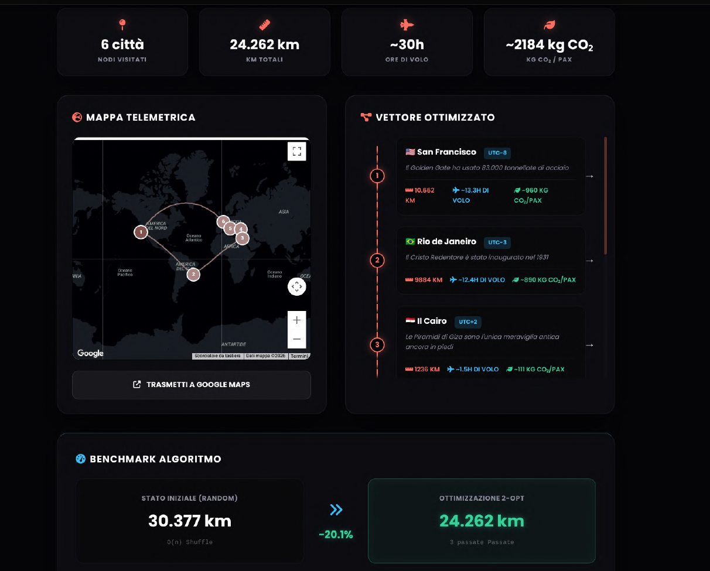

# TripNow — Full-Stack Travel-Planning Platform

TripNow is a full-stack web app for exploring destinations, generating itineraries and comparing multi-city routes. The thesis work was completed as part of my BSc in Computer and Control Engineering at **Sapienza University of Rome**.

**Core stack:** JavaScript · Node.js · Express · SQLite · REST APIs · Server-Sent Events

**Status:** academic portfolio project that runs locally. The interface is in Italian.

[Run locally](#run-locally) · [Explore the code](#code-guide)

## My contribution

**Michael Ciotti and I** co-developed the original course project, where I focused on the JavaScript frontend. I independently designed and implemented these extensions for my thesis:

- **Itinerary generation and TripBot** — integrated the Groq API into Express and streamed LLM output to the browser using Server-Sent Events (SSE).
- **Multi-city route optimization** — used a geographic distance matrix and 2-opt local search to shorten an initial randomized route and show the result on a map.
- **Personalized recommendations** — recorded interactions in SQLite and combined them with explicit favorites and destination similarity to rank suggestions.

I also added Google Maps and Leaflet planning features, Three.js destination scenes, seasonal analysis, optional TOTP authentication, service fallbacks and offline caching. The [technical highlights](#technical-highlights) describe the implementation.

<p>
  <a href="docs/screenshots/route-optimization.png"></a>
  <a href="docs/screenshots/itinerary-generation.png"></a>
</p>

*Screenshots from the thesis showing the route planner and an example itinerary.*

## Technical highlights

| Area | Implementation |
| --- | --- |
| Backend and persistence | Express JSON endpoints; SQLite tables for users, favorites, behavioral events, seasonal-analysis cache and newsletter subscriptions. |
| Real-time AI features | Itinerary generation and the TripBot travel chatbot use Groq-hosted LLMs. The server forwards text over SSE; browser clients consume the streamed response through `fetch` and readable streams. |
| Route optimization | Haversine distances, a Fisher–Yates randomized starting order and 2-opt local search. Results and routes are visualized on a map. |
| Hybrid recommendations | Destination-tag cosine similarity combined with implicit behavioral signals, using a weighted score of 60% content similarity and 40% behavioral feedback. |
| Seasonal analysis | Historical Open-Meteo climate data combined with predefined crowd and cost assumptions. A heuristic score ranks months; results are cached in SQLite for 24 hours. |
| Immersive exploration | Google Maps satellite views with camera tilt and heading, a Three.js rendering fallback, scroll-driven transitions, interactive POIs and heatmap overlays. |
| Maps and interface | Leaflet global maps, Google Maps local route building, category filters, responsive layouts and Chart.js visualizations. |

The route planner uses geographic estimates and a heuristic search, with no guarantee of an optimal route. The seasonal panel is a rule-based analysis, not a trained forecasting model; its cost and crowd estimates are illustrative.

### Additional features

- Registration, login, favorite destinations and account management, with bcrypt password hashing and optional TOTP two-factor authentication.
- Weather forecasts, historical climate charts, currency conversion and flight-search integrations. Flight results can fall back to **simulated demo data** when a provider is unavailable or unconfigured.
- Travel-guide downloads, hotel-search links, newsletter and contact forms using Nodemailer and SMTP configuration.
- A web app manifest and service-worker caching with an offline fallback. Live API features still require connectivity.

## Architecture

```text
Browser: HTML / CSS / JavaScript
  ├── Maps, route optimization, charts and Three.js scenes
  ├── REST requests and streamed SSE responses
  └── Service worker and local UI state
                │
                ▼
Node.js / Express backend
  ├── Account and favorites endpoints
  ├── SQLite persistence and cached seasonal analysis
  ├── Groq integration → SSE itinerary / chatbot streams
  ├── Weather, climate, flight and currency integrations
  └── SMTP email integration
```

Groq and other server-side credentials are read from environment variables. The Google Maps JavaScript key is configured separately in the browser-facing configuration file.

Destination pages attempt the Google Maps view when configured and fall back to the Three.js scene. Camera transitions and interaction are coordinated by `ScrollNarrative.js`; Google Maps and Three.js provide separate rendering implementations.

## Code guide

| File or directory | What to look for |
| --- | --- |
| [`src/server/server.js`](src/server/server.js) | Express endpoints, SQLite schema, Groq/SSE integration, recommendation scoring and seasonal analysis. |
| [`src/js/itinerario.js`](src/js/itinerario.js) | Itinerary request, streaming response consumption and incremental rendering. |
| [`src/js/trip-planner.js`](src/js/trip-planner.js) | Distance matrix, randomized route initialization, 2-opt and map rendering. |
| [`src/js/mappa.js`](src/js/mappa.js) | Leaflet map, points of interest and route interactions. |
| [`src/js/chatbot.js`](src/js/chatbot.js) | TripBot widget and streamed conversation interface. |
| [`src/js/recommendation/`](src/js/recommendation/) | Behavioral tracking and recommendation UI components. |
| [`src/js/predictive/PredictivePanel.js`](src/js/predictive/PredictivePanel.js) | Seasonal-analysis interface and monthly comparisons. |
| [`src/js/3d/GoogleMapsScene.js`](src/js/3d/GoogleMapsScene.js) | Google Maps satellite view, camera presets, POIs, routes and map overlays. |
| [`src/js/3d/DestinationScene.js`](src/js/3d/DestinationScene.js) | Three.js rendering, procedural fallback and optional GLTF model loading. |
| [`src/js/3d/ScrollNarrative.js`](src/js/3d/ScrollNarrative.js) | Scroll-driven camera transitions and narrative interaction phases. |
| [`src/js/3d/`](src/js/3d/) | Scene initialization, POI markers, heatmap rendering and related modules. |
| [`src/service-worker.js`](src/service-worker.js) | Caching strategies and offline fallback. |

## Run locally

### Requirements

- Node.js with native `fetch` support (version 20 or later) and npm.
- Python 3 for the static frontend server below, or an equivalent local web server such as VS Code Live Server.
- Internet access for external APIs and CDN resources. API credentials are needed for the corresponding integrations, not for every local page.

### 1. Clone and configure

```bash
git clone https://github.com/Daniele-Cacciotti/Thesis-TripNow.git
cd Thesis-TripNow

# The backend loads .env from its working directory.
cp .env.example src/server/.env
```

Edit **`src/server/.env`** with your own values. Keep `PORT=8080` to match the existing `API_BASE` in [`src/js/config.js`](src/js/config.js). Use `NODE_ENV=development` for the local setup.

To enable Google Maps, replace `INSERISCI_LA_TUA_CHIAVE_GOOGLE_MAPS` in `src/js/config.js` with your own Maps JavaScript API key. This is a browser-facing key; restrict it to your intended origins and APIs.

### 2. Start the backend

From the repository root:

```bash
cd src/server
npm ci
node server.js
```

The backend runs at **`http://127.0.0.1:8080`** with the supplied configuration. SQLite creates `mydatabase.db` in the backend working directory and initializes the required tables on startup. There is no `npm start` script in the current package.

### 3. Serve the frontend

In a second terminal, from the **repository root**:

```bash
python3 -m http.server 5500 --bind 127.0.0.1
```

Open [the homepage](http://127.0.0.1:5500/src/html/homepage.html). Serving from the repository root preserves the paths to both `src/` and `media/`.

**Quick check without API keys.** Open the homepage and follow **Destinazioni** to the [destination index](http://127.0.0.1:5500/src/html/destinazioni.html). Both pages can be served without API credentials. Some assets load from public CDNs, and generating a live itinerary requires `GROQ_API_KEY`.

Use `127.0.0.1` consistently for both frontend and backend, particularly for account features that use cookies. If you change the backend port, update `API_BASE` in `src/js/config.js`. If you change the frontend origin, check the backend CORS configuration and `ALLOWED_ORIGIN`.

### Integration configuration

| Feature | Environment variables / configuration |
| --- | --- |
| AI itineraries and TripBot | `GROQ_API_KEY` |
| Current weather | `WEATHER_API_KEY` |
| Historical climate and seasonal analysis | Open-Meteo requests; no API key is read by the current implementation. |
| Flight providers | `RAPIDAPI_KEY`, `KIWI_API_KEY`, or `AMADEUS_CLIENT_ID` and `AMADEUS_CLIENT_SECRET`, depending on the provider. |
| Currency conversion | `EXCHANGE_RATE_KEY` |
| Contact and newsletter email | `EMAIL_HOST`, `EMAIL_PORT`, `EMAIL_USER`, `EMAIL_PASS`; `ADMIN_SECRET` for the newsletter administration endpoint. |
| Google Maps | `GOOGLE_MAPS_KEY` in `src/js/config.js` |

Replace or clear example credential values for services you do not configure. Missing keys, provider failures or quota limits can leave individual features unavailable; flight-search demo results must not be interpreted as live offers. Never commit a real `.env` file.

## Validation documented in the thesis

The thesis documents manual functional checks mapped to **13 functional requirements**, targeted security and robustness checks, and local desktop/mobile Lighthouse analysis. The reported Lighthouse **Performance** scores are **97 on desktop** and **94 on mobile**, under the local test conditions described in the thesis.

These are recorded prototype results, not production benchmarks. Validation was manual; automated regression tests, load testing and production deployment are future development work.

## Scope and limitations

TripNow is an academic application for local demonstration and code review. It has not been deployed as a production service or independently security-audited. Its authentication, caching and external integrations illustrate implementation choices rather than a claim of production readiness.

Some modules use relative `/api/...` paths while other requests use `API_BASE`; those modules require the matching backend origin or an API proxy when exercised independently. Offline behavior also depends on the frontend serving path and service-worker scope. There is no automated test suite configured in the backend package; its `npm test` command is a placeholder.

## Authors and license

**Michael Ciotti** and **Daniele Cacciotti** — original collaborative web-course platform. **Daniele Cacciotti** — subsequent thesis extensions and thesis author. The individual development work is described in [My contribution](#my-contribution).

Copyright © 2026 Michael Ciotti and Daniele Cacciotti. Published for educational and portfolio review. **All rights reserved**: reuse, redistribution or modification requires the authors' prior written permission. See [`LICENSE`](LICENSE).
